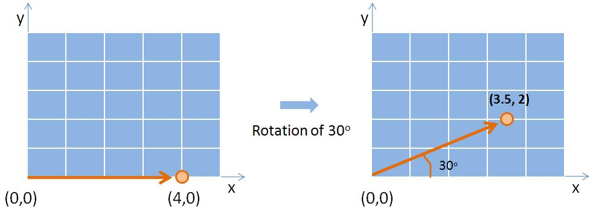

An image transformation changes the position, orientation, or size of an image by changing the coordinates of its pixels. Such transformations are useful in image processing when an image needs to be shifted, rotated, resized, or aligned with another image.

For example, in analysing an image of a cricket match, a region containing the stumps and crease may need to be moved, rotated, or resized so that it can be viewed in a suitable orientation and scale. These operations can be performed using geometric transformations.

### Basic Image Transformations

The three basic image transformations studied in this experiment are translation, rotation, and scaling.

#### Translation

Translation moves an image from one position to another without changing its orientation or size.

If a point has coordinates $(x,y)$, its translated coordinates $(x',y')$ are given by:

$$
x' = x + t_x
$$

$$
y' = y + t_y
$$

where $t_x$ and $t_y$ represent the amount of translation along the horizontal and vertical directions, respectively.

Thus, translation changes the position of an image while preserving its shape, orientation, and size.

#### Rotation

Rotation changes the orientation of an image by rotating it through a specified angle.

For a rotation by an angle $\theta$ about the origin, the transformed coordinates are given by:

$$
\begin{bmatrix}
x'\\
y'
\end{bmatrix}
=
\begin{bmatrix}
\cos\theta & -\sin\theta\\
\sin\theta & \cos\theta
\end{bmatrix}
\begin{bmatrix}
x\\
y
\end{bmatrix}
$$

For example, consider a point $(4,0)$ and rotate it by $30^\circ$ about the origin. Using the rotation matrix,

$$
\begin{bmatrix}
x'\\
y'
\end{bmatrix}
=
\begin{bmatrix}
\cos(30^\circ) & -\sin(30^\circ)\\
\sin(30^\circ) & \cos(30^\circ)
\end{bmatrix}
\begin{bmatrix}
4\\
0
\end{bmatrix}
$$

we obtain

$$
\begin{bmatrix}
x'\\
y'
\end{bmatrix}
=
\begin{bmatrix}
4\cos(30^\circ)\\
4\sin(30^\circ)
\end{bmatrix}
=
\begin{bmatrix}
3.46\\
2
\end{bmatrix}.
$$

Thus, the point $(4,0)$ is approximately transformed to the point $(3.46,2)$ after a $30^\circ$ rotation.

#### Scaling

Scaling changes the size of an image.

The transformed coordinates are given by:

$$
x' = s_xx
$$

$$
y' = s_yy
$$

where $s_x$ and $s_y$ are the scaling factors along the horizontal and vertical directions.

If $s_x=s_y$, the image is scaled uniformly and its proportions are preserved. If $s_x$ and $s_y$ are different, the image is stretched or compressed differently along the two directions.

### Affine Transformation

Translation, rotation, scaling, and shear are examples of geometric transformations that can be represented using an affine transformation.

An affine transformation can be expressed in the general form:

$$
\begin{bmatrix}
x'\\
y'
\end{bmatrix}
=
\begin{bmatrix}
a & b\\
c & d
\end{bmatrix}
\begin{bmatrix}
x\\
y
\end{bmatrix}
+
\begin{bmatrix}
t_x\\
t_y
\end{bmatrix}
$$

Here, the matrix represents the linear part of the transformation, while $t_x$ and $t_y$ represent translation.

An important property of an affine transformation is that points that lie on a straight line before transformation continue to lie on a straight line after transformation. Parallel lines also remain parallel.

The transformations studied in this experiment can therefore be represented within the affine transformation framework.

### Applying Multiple Transformations

More than one transformation can be applied to an image. For example, an image may first be translated and then rotated or scaled.

The order in which transformations are applied is important. In general, applying translation followed by rotation does not produce the same result as applying rotation followed by translation.

Therefore, when multiple transformations are used, the order of the transformations must be considered carefully.

### Why Is Interpolation Required?

An image is represented by pixels arranged on a discrete grid. The coordinates of these pixels are therefore integer-valued.

After applying a transformation such as rotation or scaling, a transformed pixel may correspond to a location that does not fall exactly on the original pixel grid. For example, a transformed location may be:

$$
(x',y')=(3.89,17.26)
$$

There is no pixel located exactly at this non-integer coordinate in the original image. The pixel value at this location must therefore be estimated from nearby pixels. This process is called **interpolation**.

Interpolation is particularly important for transformations such as rotation and scaling because they can produce non-integer pixel locations.

 

### Inverse Mapping

Suppose a transformation is represented as:

$$
\mathbf{x}'=A\mathbf{x}+\mathbf{B}
$$

where $\mathbf{x}$ is the original pixel location and $\mathbf{x}'$ is the transformed location.

To determine the pixel value for a location in the transformed image, the corresponding location in the original image can be found using the inverse transformation:

$$
\mathbf{x}=A^{-1}(\mathbf{x}'-\mathbf{B})
$$

The calculated location in the original image may not be an integer coordinate. Interpolation is then used to estimate the pixel value at that location.

Thus, the basic steps for obtaining a transformed image are:

1. Consider a pixel location in the transformed image.
2. Use the inverse transformation to determine its corresponding location in the original image.
3. If the corresponding location is not an integer pixel location, use interpolation to estimate its pixel value.
4. Assign the estimated value to the transformed image.

### Interpolation Methods

Three commonly used interpolation methods are studied in this experiment.

#### Nearest-Neighbor Interpolation

Nearest-neighbor interpolation assigns the value of the pixel closest to the required location.

For example, if the required location lies between several pixels, the value of the nearest pixel is selected.

This method is simple and fast, but the transformed image may appear blocky or jagged, especially when the image is enlarged or rotated.

#### Bilinear Interpolation

Bilinear interpolation uses the four pixels surrounding the required location.

The value at the required location is calculated as a weighted average of these four neighbouring pixels. The weights depend on the distances between the required location and the neighbouring pixels.

Bilinear interpolation generally produces smoother results than nearest-neighbor interpolation.

#### Bicubic Interpolation

Bicubic interpolation uses a larger neighbourhood of pixels, commonly a $4\times4$ neighbourhood, to estimate the value at the required location.

It generally produces smoother results than nearest-neighbor and bilinear interpolation, although it requires more computation.

Thus, the interpolation methods can be broadly compared as follows:

| Interpolation method | Pixels considered | General characteristic                                            |
| -------------------- | ----------------: | ----------------------------------------------------------------- |
| Nearest-neighbor     |                 1 | Simple and fast; may produce blocky results                       |
| Bilinear             |                 4 | Produces smoother results                                         |
| Bicubic              |        $4\times4$ | Generally produces smoother results but requires more computation |

### Effect of Image Transformations

Each transformation produces a different effect on the image:

- **Translation** changes the position of the image.
- **Rotation** changes the orientation of the image.
- **Scaling** changes the size of the image.
- **Interpolation** determines how pixel values are estimated when transformed locations do not fall exactly on the pixel grid.
- **The order of transformations** can affect the final transformed image when multiple transformations are applied.

In this experiment, the effects of translation, rotation, and scaling can be observed by applying these transformations to an image. The effect of different interpolation methods and the significance of the order of multiple transformations can also be studied.
